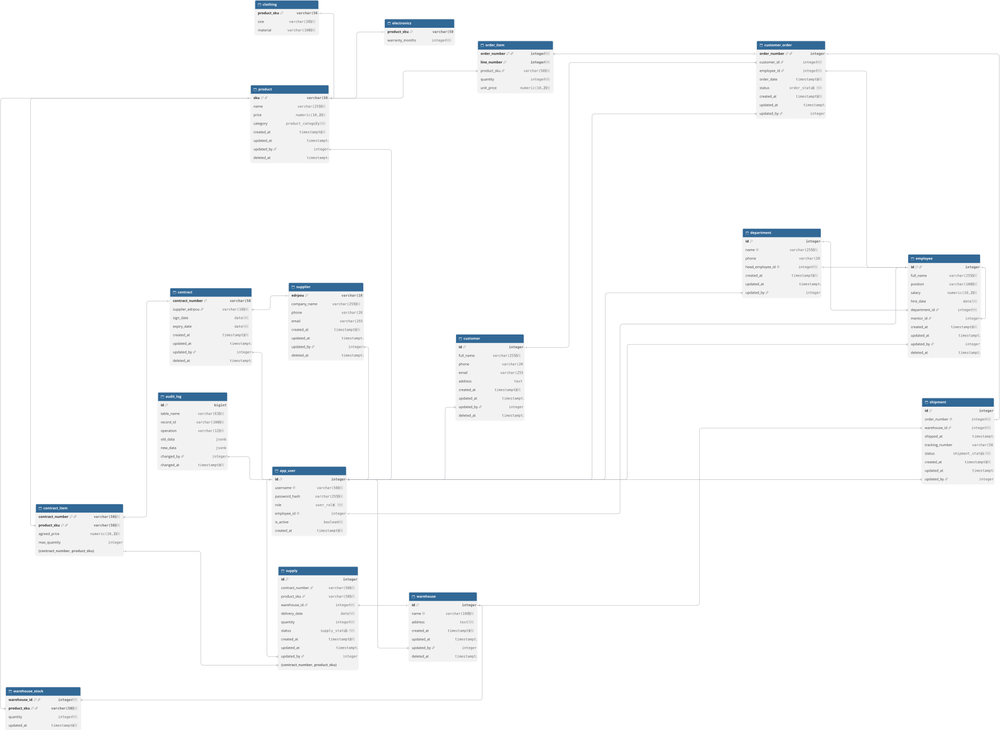

# Система управління ланцюгами постачання

Лабораторна робота з баз даних: проєктування та реалізація реляційної БД для компанії,
яка закуповує товари в постачальників, зберігає їх на складах і продає клієнтам.



## Мета

- спроєктувати схему БД предметної області (понад 15 сутностей) з ключами та зв'язками;
- реалізувати її в PostgreSQL з soft delete та аудитом змін;
- винести бізнес-логіку в збережені процедури, функції, тригери та представлення;
- підібрати індекси різних типів під реальні запити;
- працювати з БД із коду через патерни Repository + Unit of Work, де всі запити йдуть лише через процедури та представлення.

## Стек

- PostgreSQL 14+ (перевірено на 18)
- Python 3.12+
- `psycopg 3`
- `psql` \ pgAdmin 4

## Предметна область

Компанія має відділи та працівників. **Постачальники** підписують **контракти**, у яких зафіксовано товари,
ціни та ліміти. За контрактами надходять **поставки** на **склади** — і залишки на складі зростають.
**Клієнти** роблять **замовлення**, менеджер їх підтверджує, комірник формує **відвантаження** —
і залишки зменшуються. Кожна зміна фіксується: хто й коли змінив запис, а повна історія — у журналі аудиту.

## Таблиці

Усі об'єкти лежать у схемі `scm`. 17 таблиць, 30 зовнішніх ключів, 5 ENUM-типів.

### Користувачі та структура компанії

| Таблиця | Призначення | Ключ |
|---|---|---|
| `app_user` | користувачі системи та їхні ролі (`admin`, `manager`, `sales`, `warehouse_worker`) | `id` |
| `department` | відділи компанії | `id` |
| `employee` | працівники: посада, зарплата, відділ, ментор | `id` |
| `audit_log` | журнал змін усіх таблиць: операція, старі й нові дані (JSONB), автор, час | `id` |

### Товари

| Таблиця | Призначення | Ключ |
|---|---|---|
| `product` | каталог товарів; `category` визначає підтип | `sku` |
| `electronics` | підтип: гарантія | `product_sku` |
| `clothing` | підтип: розмір, матеріал | `product_sku` |

### Продажі

| Таблиця | Призначення | Ключ |
|---|---|---|
| `customer` | клієнти (потрібен телефон або email) | `id` |
| `customer_order` | замовлення клієнта та його статус | `order_number` |
| `order_item` | рядки замовлення; ціна фіксується на момент продажу | (`order_number`, `line_number`) |
| `shipment` | відвантаження замовлення зі складу, трек-номер | `id` |

### Постачання та склади

| Таблиця | Призначення | Ключ |
|---|---|---|
| `supplier` | постачальники | `edrpou` |
| `contract` | контракти з постачальниками, термін дії | `contract_number` |
| `contract_item` | товари контракту: узгоджена ціна та ліміт кількості | (`contract_number`, `product_sku`) |
| `warehouse` | склади | `id` |
| `supply` | поставка: контракт × товар × склад, дата, кількість, статус | `id` |
| `warehouse_stock` | поточні залишки товару на складі | (`warehouse_id`, `product_sku`) |

### Зв'язки

| Зв'язок | Тип | Примітка |
|---|---|---|
| `department` → `employee` (керівник) | 1:1 | FK відкладений до `COMMIT`: відділ і керівник посилаються один на одного |
| `employee` → `department` | M:1 | працівник у відділі |
| `employee` → `employee` | M:1 | рекурсивний зв'язок «ментор», без циклів |
| `app_user` → `employee` | 1:1 | обліковий запис працівника |
| `product` → `electronics` / `clothing` | 1:1 | неперетинна спеціалізація |
| `customer_order` → `customer`, `employee` | M:1 | хто замовив і хто обробляє |
| `order_item` → `customer_order` | M:1 | слабка сутність, `ON DELETE CASCADE` |
| `order_item` → `product` | M:1 | |
| `shipment` → `customer_order` | 1:1 | одне відвантаження на замовлення |
| `shipment` → `warehouse` | M:1 | |
| `contract` → `supplier` | M:1 | |
| `contract_item` → `contract`, `product` | M:1 | зв'язок M:N між контрактами й товарами |
| `supply` → `contract_item` | M:1 | складений FK: товар має бути в контракті |
| `supply` → `warehouse` | M:1 | |
| `warehouse_stock` → `warehouse`, `product` | M:1 | зв'язок M:N між складами й товарами |
| `updated_by`, `changed_by` → `app_user` | M:1 | автор зміни (у 10 таблицях та в аудиті) |

## Що реалізовано

| № | Пункт умови | Реалізація |
|---|---|---|
| 1 | Схема БД | `diagram/supply_chain.dbml` → `diagram/supply_chain.svg` |
| 2 | ≥ 15 сутностей | 17 таблиць |
| 3 | Soft delete; дата й автор зміни | `deleted_at` у 6 таблицях (`employee`, `customer`, `product`, `supplier`, `contract`, `warehouse`); `updated_at` + `updated_by` у 10 таблицях; повна історія в `audit_log` |
| 4 | Реляційна СУБД | PostgreSQL |
| 5 | Процедури, функції, тригери, VIEW (≥ 10) | 21 процедура, 8 функцій, 13 тригерних функцій (42 тригери на таблицях), 15 представлень |
| 6 | Індекси (≥ 2 типи) | B-tree (прості, складені, покриваючий, з фільтром, на функції), Hash, GIN, BRIN |
| 7 | Repository + Unit of Work | `app/`: 6 репозиторіїв і Unit of Work; застосунок не має доступу до таблиць |

### Тригери

- **Аудит** — кожна зміна у 15 таблицях пишеться в `audit_log` (`INSERT`, `UPDATE`, `DELETE`, `SOFT_DELETE`, `RESTORE`).
- **Автор і час зміни** — `updated_at` / `updated_by` заповнюються автоматично з `sp_set_current_user`.
- **Soft delete** — `DELETE` перетворюється на `UPDATE deleted_at = now()`.
- **Бізнес-правила:**
  - переходи статусів замовлення (`new → confirmed → shipped → delivered`, скасування), поставки та відвантаження;
  - поставка лише в межах терміну та ліміту контракту, лише на відкритий склад;
  - доставлена поставка збільшує залишок, відправлене відвантаження його списує й оновлює статус замовлення;
  - керівника відділу не можна звільнити чи перевести; ланцюжок менторів без циклів;
  - товар у `electronics` / `clothing` лише відповідної категорії.

### Функції

| Функція | Що повертає |
|---|---|
| `fn_order_total` | суму замовлення |
| `fn_stock_available` | залишок товару на складі або на всіх складах |
| `fn_is_contract_valid` | чи діє контракт на дату |
| `fn_contract_remaining` | скільки ще можна поставити за контрактом |
| `fn_supplier_turnover` | оборот постачальника за період |
| `fn_employee_mentees` | усіх стажерів ментора (рекурсивно) |
| `fn_record_history` | історію змін запису з журналу аудиту |
| `fn_current_user_id` | поточного користувача транзакції |

### Представлення

`v_app_user`, `v_department`, `v_employee`, `v_customer`, `v_product`, `v_supplier`, `v_contract`, `v_warehouse`
показують лише активні (не видалені) записи. Також є `v_order_summary` (замовлення з сумою та відвантаженням),
`v_order_item`, `v_shipment`, `v_supply_detail`, `v_stock`, `v_audit_trail` і `v_deleted_records` (усі видалені записи
з автором видалення).

### Права доступу

Роль застосунку `scm_app` не має доступу до таблиць: лише `SELECT` з представлень та `EXECUTE` процедур і функцій.
Процедури та функції виконуються з правами власника (`SECURITY DEFINER`). Тому змінити дані в обхід бізнес-правил
із застосунку неможливо.

## Застосунок (п.7)

Логічно пов'язані сутності: **клієнт → замовлення → рядки замовлення → відвантаження → залишки**.

```python
with factory.begin(user_id) as uow:
    customer_id = uow.customers.create("ТОВ «Приклад»", "+380441234567", None, None)
    order_number = uow.orders.create(customer_id, employee_id)
    uow.orders.add_item(order_number, "EL-PHONE-001", 2)
    uow.orders.set_status(order_number, OrderStatus.CONFIRMED)
    uow.commit()          # без commit() усе відкотиться
```

| Шар | Файл | Що робить |
|---|---|---|
| Моделі | `supply_chain/models.py` | `dataclass`-и; ENUM-типи PostgreSQL ↔ Python `StrEnum` |
| Репозиторії | `supply_chain/repositories/` | запис — `CALL scm.sp_*`, читання — `scm.v_*` і `scm.fn_*` |
| Unit of Work | `supply_chain/unit_of_work.py` | одна транзакція на бізнес-операцію; встановлює автора змін; `begin_read_only()` — транзакція `READ ONLY` |
| Демо | `main.py` | 5 сценаріїв |

| Репозиторій | Процедури | Представлення / функції |
|---|---|---|
| `UserRepository` | — | `v_app_user` |
| `CustomerRepository` | `sp_customer_create/update/delete/restore` | `v_customer`, `v_deleted_records`, `fn_record_history` |
| `ProductRepository` | `sp_product_create/update/delete/restore` | `v_product` |
| `OrderRepository` | `sp_order_create`, `sp_order_add_item`, `sp_order_remove_item`, `sp_order_set_status` | `v_order_summary`, `v_order_item`, `fn_order_total` |
| `ShipmentRepository` | `sp_shipment_create`, `sp_shipment_set_warehouse`, `sp_shipment_set_status` | `v_shipment` |
| `StockRepository` | — (залишки змінюють тригери) | `v_stock`, `fn_stock_available` |

Сценарії демо:
1. Читання каталогу та залишків.
2. Новий клієнт + замовлення + рядки + підтвердження — в одній транзакції.
3. Відвантаження: зміна складу, списання залишків, статус замовлення стає `delivered`.
4. Помилка на останньому кроці — `ROLLBACK` усіх створених у транзакції записів.
5. Оновлення, soft delete, відновлення клієнта та історія змін з автором кожної операції.

## Структура проєкту

```
BD_Lab/
├── README.MD
├── diagram/
│   ├── supply_chain.dbml        схема для dbdiagram.io
│   └── supply_chain.svg         зображення схеми
├── sql/                         виконуються в порядку номерів
│   ├── 00_run_all.sql           запускає 01–09 через psql
│   ├── 01_schema.sql            схема scm, ENUM-типи, таблиці, ключі, CHECK (перестворює схему)
│   ├── 02_indexes.sql           індекси
│   ├── 03_functions.sql         функції
│   ├── 04_triggers.sql          тригери
│   ├── 05_views.sql             представлення
│   ├── 06_procedures.sql        збережені процедури
│   ├── 07_grants.sql            роль застосунку та права
│   ├── 08_seed.sql              тестові дані
│   └── 09_tests.sql             перевірка 14 бізнес-правил, звіти, EXPLAIN для індексів
└── app/
    ├── main.py                  демо
    ├── config.json              рядок підключення, логіни користувачів демо
    ├── requirements.txt
    └── supply_chain/
        ├── config.py
        ├── models.py
        ├── unit_of_work.py
        └── repositories/        base, users, customers, products, orders, shipments, stock
```

## Запуск

### 1. База даних

Через psql (з кореня проєкту):

```powershell
$env:PGPASSWORD = "<пароль postgres>"
$psql = "C:\Program Files\PostgreSQL\18\bin\psql.exe"
& $psql -U postgres -c "CREATE DATABASE lab_supply_chain"
& $psql -U postgres -d lab_supply_chain -f sql/00_run_all.sql
& $psql -U postgres -d lab_supply_chain -c "CREATE ROLE scm_api LOGIN PASSWORD 'scm_api' IN ROLE scm_app"
```

Через pgAdmin: створіть базу `lab_supply_chain`, відкрийте Query Tool і виконайте файли `sql/01`–`sql/09`
**по черзі** (`00_run_all.sql` у pgAdmin не працює — це команди psql). Потім виконайте `CREATE ROLE` з прикладу вище.

`01_schema.sql` видаляє й створює схему `scm` заново, тому після нього завжди виконуйте всі наступні файли.
Логін `scm_api` створюється один раз — він не зникає при перестворенні схеми.

### 2. Застосунок

```powershell
cd app
python -m venv .venv
.venv\Scripts\python -m pip install -r requirements.txt
.venv\Scripts\python main.py
```

Рядок підключення береться з аргументу командного рядка, змінної `SCM_CONNECTION` або `app/config.json`
(у такому порядку):

```powershell
.venv\Scripts\python main.py "host=localhost port=5432 dbname=lab_supply_chain user=scm_api password=scm_api"
```

## Умова лаби

1) Розробити
схему бази даних з вказанням зв’язків між об’єктами, полями, ключами й тд.
(https://app.diagrams.net/ https://dbdiagram.io/home , тощо)

2) Мінімальна кількість сутностей 15.

3) Сутності повинні спиратися на сформовані вимоги. Хоча б деякі сутності мають
підтримувати “Soft delete”, деякі сутності мають зберігати
дату останньої зміни даних та користувача що їх змінив.

4) Реалізувати модель у одній з реляційних СУБД (MsSQL, MySQL/MariaDb, PostgreSQL)

5) Створення й використання збережених процедур, користувацьких функцій, тригерів, розрізів даних (View), тощо. В першу чергу для роботи з сутностями з п.3 (мінімум 10)

6) Створення індексів (хоча б 2 різні типи)

7) Робота з декількома сутностями БД з коду. Реалізувати комбінацію патернів Repository + Unit of Work для декількох логічно-зв'язаних сутностей, де усі запити будуть йти через використання збережених процедур та розрізів даних.
